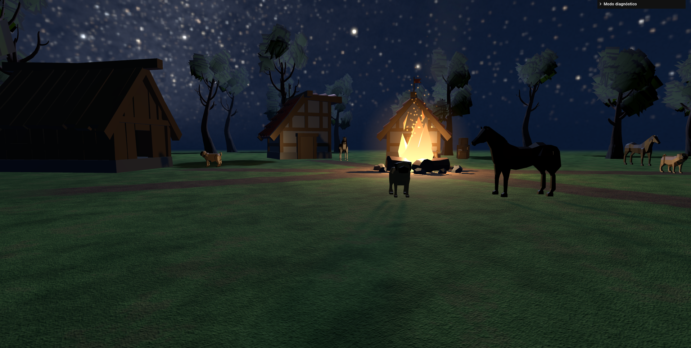

# Vila Medieval

Vila medieval em 3D feita com Three.js, que dá para explorar em primeira pessoa à noite, ao redor de uma fogueira.

Projeto da disciplina de Computação Gráfica.



## Funcionalidades

- Exploração em primeira pessoa com mouse e teclado
- Casas, árvores, cavalos e cachorros posicionados pela vila
- Fogueira com luz tremulante, chama animada, fagulhas e fumaça
- Céu estrelado (HDR), lua com luz azulada e neblina
- Chão com texturas de grama e terra, com praça e caminhos até as casas
- Sombras em tempo real
- Modo diagnóstico para estudar conceitos de renderização

## Tecnologias

- [Three.js](https://threejs.org/)
- [Vite](https://vitejs.dev/)
- JavaScript

## Como executar

Requisitos: [Node.js](https://nodejs.org/) `v22.23.1` ou superior.

```bash
# Instalar as dependências
npm install

# Rodar em modo de desenvolvimento
npm run dev

# Gerar a versão de produção
npm run build
```

Depois, abra o endereço mostrado no terminal (geralmente `http://localhost:5173`).

## Controles

| Tecla / ação | Função |
| --- | --- |
| Clique na tela | Captura o mouse |
| Mouse | Gira a câmera |
| `W` `A` `S` `D` ou setas | Anda |
| `Shift` | Corre |
| `Esc` | Libera o mouse |

### Modo diagnóstico

O painel no canto da tela e os atalhos numéricos mostram conceitos de renderização:

| Tecla | Função |
| --- | --- |
| `1` | Wireframe |
| `2` | Visualização de profundidade (z-buffer) |
| `3` | Back-face culling |
| `4` | Frustum da câmera, visto de cima |
| `5` | Frustum culling |

O painel também mostra FPS, draw calls e triângulos.

## Estrutura do projeto

```
.
├── index.html
├── package.json
└── src/
    ├── main.js            # Cena, luzes, vila, fogueira e loop de animação
    ├── modelos/
    │   ├── construcoes/   # Casas e fogueira (.glb)
    │   ├── arvore/        # Árvores (.fbx)
    │   └── animal/        # Cavalo e pug (.fbx)
    └── texturas/          # Céu HDR, grama, terra e máscaras
```

## Nota de Trasparência

Usamos o Claude (Anthropic) como apoio durante o desenvolvimento. Esta seção registra o que foi pedido, o que foi validado ou alterado por nós e o que foi descartado.

### O que foi pedido para à IA

- Geração das texturas de grama e terra (licenciadas como CC0, veja [Créditos](#créditos-licenças-e-referências)).
- Otimizações de desempenho (sombra estática da lua, clonagem de modelos, limites de resolução).
- Sugestões de melhorias simples e estudo de colisão.
- Esqueleto para o README

### O que foi validado ou alterado manualmente

- Medimos o efeito de cada otimização com o painel de diagnóstico (FPS, draw calls e triângulos).
- Escolhemos os modelos, as posições de casas, árvores e animais e a organização da vila.
- Decidimos como seria o layout da vila.
- Correção do código relacionado à animação dos animais.
- Quantidade de objetos inseridos (casas, fogueira, animais, árvores, etc.) .

### O que foi descartado

- **Rio com partículas de água:** ficou pesado demais e foi removido.
- **Gerador aleatório de floresta:** não foi adotado. A versão final usa uma lista fixa de 32 posições de árvores.
- **Flores:** foram removidas do projeto depois de dificuldades para ajustar o tamanho.
- **Colisão com casas, árvores e fogueira:** foi discutida, mas não está incluída na versão final.
- **Atualização da sombra da fogueira a cada 3 quadros:** foi sugerida (a cena ficou ligeiramente mais leve, porém o desenho das sombras ficou estranho), mas não aplicada. A sombra é calculada em todo quadro .

## Créditos

### Assets

| Asset | Autor | Fonte | Licença |
| --- | --- | --- | --- |
| `casas e fogueira` | `Quaternius` | [`Ultimate Fantasy RTS`](https://poly.pizza/bundle/Stylized-Nature-MegaKit-T34GZFA0fm) | `CC0 1.0` |
| `árvores` | `Quaternius` | [`Stylized Nature MegaKit`](https://poly.pizza/bundle/Ultimate-Fantasy-RTS-nSDjmACoSU) | `CC0 1.0` |
| `cavalo e pug` | `Quaternius` | [`Farm Animal Pack`](https://poly.pizza/bundle/Farm-Animal-Pack-1kUvRTPLzT) | `CC0 1.0` |
| `céu HDR` | `Greg Zaal` | [`Satara Night HDRI`](https://polyhaven.com/a/satara_night) | `CC0 1.0` |
| `texturas de grama e terra` | `Geradas proceduralmente com ajuda do Claude (Anthropic)` | [`Claude`](https://claude.ai) | `CC0 1.0` |

### Bibliotecas
 
| Biblioteca | Uso | Licença |
| --- | --- | --- |
| [Three.js](https://threejs.org/) | Renderização 3D, carregadores de modelos, controles e utilitários | MIT |
| [Vite](https://vitejs.dev/) | Servidor de desenvolvimento e build | MIT |
| [lil-gui](https://lil-gui.georgealways.com/) | Painel de diagnóstico | MIT |

### Referências
 
- [Documentação do Three.js](https://threejs.org/docs/)
- [Poly Pizza](https://poly.pizza/), de onde vieram os modelos
- [Poly Haven](https://polyhaven.com/), de onde veio o HDRI
- [Quaternius](https://quaternius.com/), autor dos modelos

### Equipe

- [`Filipe Fiorio`](https://github.com/FilipeFiorio)
- [`Gustavo Mastelaro`](https://github.com/gustavoMastelaro)

## Licença

Este projeto está dedicado ao domínio público sob a licença
[CC0 1.0 Universal](https://creativecommons.org/publicdomain/zero/1.0/).
Na medida do possível, os autores abriram mão de todos os direitos
autorais sobre o código. Veja o arquivo [LICENSE](LICENSE).

Os assets de terceiros seguem as licenças listadas em [Créditos](#créditos).
